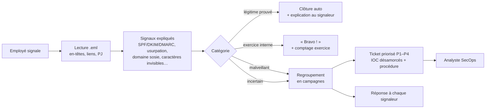

# Phishing Report Triage

**Le poste de traitement des e-mails signalés d'une équipe SecOps : de la boîte
« signalements » au ticket priorisé, avec une réponse à chaque employé.**

Chaque jour, des collaborateurs cliquent sur « Signaler un phishing ». Derrière,
une équipe sécurité doit trier : vrai phishing ou faux signalement ? une seule
victime ou toute l'entreprise ? que bloquer, qui prévenir, dans quel ordre ?
Ce projet automatise ce triage **sans retirer l'humain de la décision**, et
l'éprouve sur **de vrais e-mails de phishing** (corpus public Phishing Pot).

> Projet défensif. Les e-mails sont **lus** et analysés ; aucun lien n'est
> ouvert, aucune pièce jointe n'est exécutée. Tous les indicateurs publiés dans
> ce dépôt sont **désamorcés** (`hxxps://`, `[.]`).

---

## Trois études qui ont guidé la conception

| Étude | Constat | Ce que le projet en fait |
|---|---|---|
| **Lain et al.**, *Phishing in Organizations*, IEEE S&P 2022 (ETH Zurich, 14 733 employés, 15 mois) | Les **signalements des employés** arrivent vite (30 à 40 % en moins de 30 min) et ont révélé 252 vraies campagnes ; un **retour positif** pousse à signaler davantage. Mais ~1 signalement sur 3 n'est pas du phishing. | Les signalements d'une même campagne sont **fusionnés** en un ticket, et leur **nombre** fait monter la priorité. Les faux signalements prouvés légitimes sont **clos automatiquement**. Chaque signaleur reçoit un **remerciement**, même pour un faux signalement. |
| **Alahmadi et al.**, *99% False Positives*, USENIX Security 2022 | Les analystes SOC sont noyés sous les alertes et manquent de **contexte** pour décider. | Chaque verdict est **expliqué** en clair (« le lien affiche paypal.com mais mène vers… »). Un ticket = tout ce qu'il faut pour décider en une minute. |
| **Ho et al.**, *Understanding the Efficacy of Phishing Training in Practice*, IEEE S&P 2025 (UC San Diego Health, 19 789 employés, 8 mois) | Les formations classiques ont un effet **quasi nul** : −1,7 point de taux d'échec pour la formation intégrée, aucun lien mesurable pour la formation annuelle. | La défense ne repose pas sur « l'employé ne cliquera pas » : on **retire** le message, on **bloque**, on **cherche qui a cliqué**. Les réponses aux signaleurs remplacent la culpabilisation par du renforcement positif. |

Détails et choix de conception : [`docs/research.md`](docs/research.md).

## Le circuit



**Règle de prudence.** L'outil ne clôt **jamais** un signalement sur une simple
absence d'indices. « Légitime » exige une **preuve positive** : expéditeur connu
de l'organisation, authentifié (DMARC=pass), liens vers des domaines connus,
réponse non détournée. Un expéditeur connu qui ne coche pas tout (compte
fournisseur compromis ?) part chez l'analyste. Tout ce qui est incertain va en
file « suspect » : **l'outil trie, l'humain tranche**.

## Résultats

Une semaine simulée pour une organisation fictive de 115 personnes : **362
signalements** de **120 e-mails** (95 vrais e-mails de phishing, 24 e-mails
légitimes signalés à tort, 1 exercice de sensibilisation).

| Mesure | Résultat |
|---|---|
| Dossiers à traiter | **362 signalements → 75 tickets** (−79 %) |
| Vrais phishing clos à tort comme légitimes | **0 / 95** |
| Vrais phishing classés dans une catégorie précise | 66 / 95 (les 29 autres vont à l'analyste, jamais en clôture) |
| E-mails légitimes classés malveillants | **0 / 24** |
| Signalements traités automatiquement (légitimes + exercice) | 42 signalements, chacun avec une réponse |
| Regroupement en campagnes (paires d'e-mails) | précision 0,95 · rappel 1,00 |
| Signaux expliqués par ticket malveillant | 3,5 en moyenne |

**Contrôle à grande échelle** sur **2 998 vrais e-mails de phishing** du corpus :
**0** classé légitime. 59 % reçoivent une catégorie précise, 41 % partent en
file « suspect » pour un analyste.

Rapport complet et limites : [`report/results.md`](report/results.md).
File de traitement générée : [`tickets/README.md`](tickets/README.md).
Exemple de ticket : [`tickets/TCK-0001.md`](tickets/TCK-0001.md).
Réponses aux signaleurs (FR/EN) : [`replies/README.md`](replies/README.md).
Procédure opérationnelle : [`docs/playbook.md`](docs/playbook.md).

## Lancer le projet

```bash
git clone https://github.com/FatimaZahraRH/Phishing_Report_Triage.git
cd Phishing_Report_Triage
python3 -m venv venv && source venv/bin/activate
pip install -r requirements.txt

python -m pytest -q        # 15 tests
python scripts/run.py      # signalements -> tickets, réponses, métriques
```

Aucune dépendance hors bibliothèque standard (pytest pour les tests). Les
données extraites sont versionnées dans `data/`, donc tout tourne sans
télécharger le corpus. Pour tout reconstruire depuis les `.eml` d'origine :

```bash
git clone --depth 1 https://github.com/rf-peixoto/phishing_pot.git
python scripts/build_mailbox.py --corpus phishing_pot/email
python scripts/corpus_check.py  --corpus phishing_pot/email --n 3000
```

## Organisation

```
src/phishtriage/
  parse.py        lecture .eml : en-têtes, SPF/DKIM/DMARC, liens (+ texte affiché), pièces jointes
  indicators.py   signaux de triage, chacun avec son explication
  classify.py     catégorie + règle de prudence (preuve positive pour « légitime »)
  cluster.py      regroupement des signalements en campagnes
  tickets.py      priorité P1–P4, indicateurs désamorcés, rendu Markdown
  playbooks.py    procédure par catégorie
  reply.py        réponse au signaleur, FR / EN
  benign.py       e-mails légitimes et exercice (écrits à la main)
  pipeline.py     chaîne complète + métriques
scripts/          build_mailbox.py, run.py, corpus_check.py
data/             e-mails extraits (désamorcés), signalements, vérité terrain
tickets/          75 tickets générés + file de traitement
replies/          réponses générées + exemples
docs/             playbook.md, research.md
report/           results.md, metrics.json, corpus_check.json
tests/            15 tests
```

## Limites assumées

- **E-mails légitimes écrits à la main.** Aucun corpus public d'e-mails
  d'entreprise récents n'existe ; les 24 messages légitimes représentent des
  cas typiques. Le score « 0 légitime classé malveillant » est donc un contrôle
  de cohérence, pas une preuve sur du trafic réel.
- **Signalements simulés.** Qui signale, combien et quand est tiré au hasard
  (graine fixe). Les e-mails malveillants, eux, sont réels. Ici 12 % des
  signalements concernent des e-mails légitimes, contre environ 32 % dans
  l'étude de Lain et al. : en conditions réelles, la clôture automatique
  servirait donc encore plus.
- **Règles écrites à la main**, ajustées en lisant un échantillon du corpus.
  Le contrôle sur 2 998 e-mails mesure la sécurité (0 clôture à tort), pas une
  précision « en aveugle ».
- **41 % de « suspect » sur le corpus.** C'est le prix de la règle de
  prudence : l'outil préfère envoyer un e-mail douteux à un humain plutôt que
  de deviner. Le regroupement en campagnes réduit cette charge.
- **Pas de réputation externe** (VirusTotal, listes de blocage) : l'outil
  fonctionne hors ligne. C'est le premier ajout à faire en production.

## Références

- D. Lain, K. Kostiainen, S. Čapkun, *Phishing in Organizations: Findings from a
  Large-Scale and Long-Term Study*, IEEE S&P 2022. [arXiv:2112.07498](https://arxiv.org/abs/2112.07498)
- B. A. Alahmadi, L. Axon, I. Martinovic, *99% False Positives: A Qualitative
  Study of SOC Analysts' Perspectives on Security Alarms*, USENIX Security 2022.
  [lien](https://www.usenix.org/conference/usenixsecurity22/presentation/alahmadi)
- G. Ho, A. Mirian et al., *Understanding the Efficacy of Phishing Training in
  Practice*, IEEE S&P 2025. [PDF](https://sysnet.ucsd.edu/~voelker/pubs/phishtrain-oakland25.pdf)
- R. Peixoto, *Phishing Pot* — vrais e-mails de phishing collectés par pots de
  miel, CC BY-NC 4.0. [github.com/rf-peixoto/phishing_pot](https://github.com/rf-peixoto/phishing_pot)
