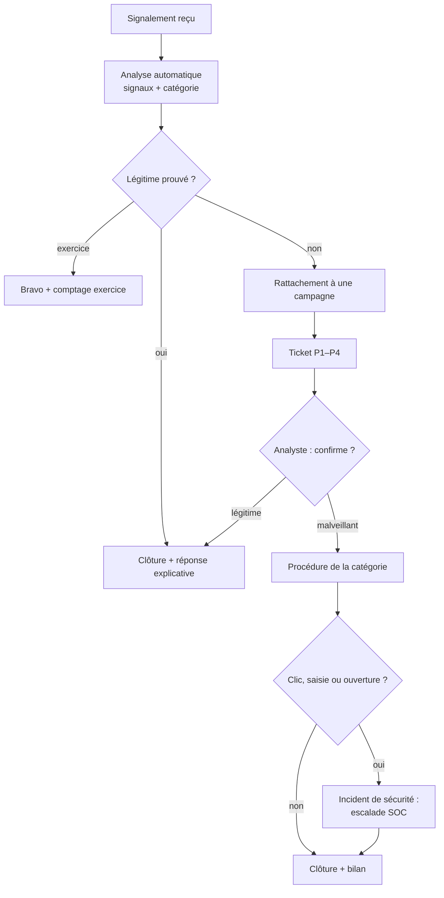

# Procédure : traitement d'un e-mail signalé

Procédure de l'équipe SecOps pour la boîte « signalements ». L'outil prépare
les étapes 1 à 4 ; l'analyste valide et exécute la suite.

## Circuit

## Délais de prise en charge (proposition)

| Priorité | Exemples | Prise en charge |
|---|---|---|
| **P1** | pièce jointe dangereuse ; vol d'identifiants signalé par 5 personnes ou plus ; fausse facture reçue par la Finance | 15 min |
| **P2** | vol d'identifiants ; fraude au paiement ; campagne suspecte large | 1 h |
| **P3** | suspect isolé ; chantage ; spam large | 4 h ouvrées |
| **P4** | spam / arnaque isolée | 1 jour ouvré |

## Étapes

1. **Accuser réception.** Une réponse part vers chaque signaleur (`replies/`).
   Toujours un remerciement, même pour un faux signalement.
2. **Lire le ticket.** Les signaux expliqués disent *pourquoi*. Vérifier en
   priorité : authentification de l'expéditeur, destination réelle des liens,
   pièces jointes.
3. **Mesurer l'ampleur.** Nombre de signaleurs et services touchés. Chercher
   dans la passerelle mail **tous** les destinataires (pas seulement les
   signaleurs) avec l'objet et l'expéditeur du ticket.
4. **Contenir.** Retirer le message des boîtes ; bloquer domaines et hash
   (indicateurs fournis désamorcés : remettre `.` et `http` avant de les saisir
   dans les outils).
5. **Chercher les victimes.** Journaux proxy/DNS : qui a visité les domaines
   des liens ? Journaux EDR : qui a ouvert la pièce jointe ?
6. **Remédier.** Mot de passe réinitialisé, sessions révoquées, MFA vérifiée ;
   poste isolé si une pièce jointe a été ouverte.
7. **Clore et documenter.** Ce qui a été bloqué, combien de personnes
   touchées, combien de victimes, délai entre premier signalement et retrait.

## Indicateurs à suivre chaque mois

- **Taux de signalement** des campagnes réelles et des exercices.
- **Délai avant le premier signalement** (Lain et al. : 30 à 40 % des
  signalements arrivent en moins de 30 min ; c'est la fenêtre d'action).
- **Délai entre premier signalement et retrait** des boîtes.
- **Part de faux signalements** clos automatiquement.
- **Charge de la file « suspect »** : si elle grossit, ajuster les signaux,
  jamais élargir la liste des expéditeurs connus « pour faire de la place ».
